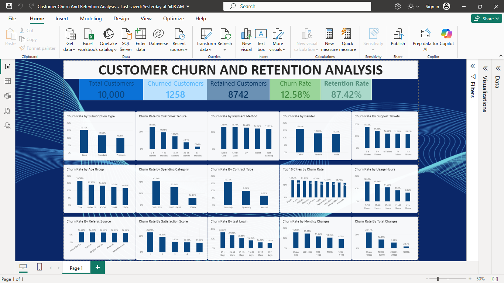

# Customer Churn & Retention Analysis

## Project Overview

This project analyzes customer churn and retention using SQL, Power BI, and DAX. The objective is to identify patterns in customer behavior, understand factors associated with churn, and develop data-driven recommendations to improve customer retention.

## Dashboard Preview

The Power BI dashboard summarizes customer churn and retention KPIs and explores churn patterns across customer demographics, subscription types, tenure, payment methods, usage, and spending.

## Business Problem

Customer churn can reduce revenue and make long-term growth more difficult. This analysis explores customer demographics, subscription details, tenure, spending, usage patterns, and support interactions to identify customer groups with higher churn rates.

## Project Objectives

- Calculate key customer churn and retention KPIs.
- Analyze churn across customer demographics and subscription characteristics.
- Investigate relationships between customer tenure, usage, charges, and churn.
- Build an interactive Power BI dashboard.
- Develop actionable, evidence-based retention recommendations.

## Tools Used

- **MySQL:** Data exploration, aggregation, and churn analysis.
- **Power BI:** Dashboard development and data visualization.
- **DAX:** KPI calculations and churn and retention measures.
- **GitHub:** Project documentation and version control.

## Data Cleaning & Preparation

The customer churn dataset was reviewed and prepared for analysis using SQL and Power BI. The preparation process focused on ensuring that customer information and churn-related fields could be analyzed consistently.

The following checks and preparation activities were considered during the analysis:

- **Data Structure Review:** Reviewed the dataset columns to understand customer demographics, subscription details, billing information, engagement, and churn status.
- **Data Quality Checks:** Identified the need to check for missing values, duplicate customer records, and inconsistent values.
- **Column Review:** Reviewed relevant fields, including customer ID, age, gender, subscription type, contract type, monthly charges, total charges, tenure, payment method, and churn status.
- **Categorical Analysis:** Used customer attributes and relevant categories to compare churn rates across different customer groups.
- **SQL Analysis:** Used SQL queries to calculate customer counts, churn counts, retained customers, and churn percentages across different dimensions.
- **Power BI Preparation:** Used the relevant fields and calculated measures to present key performance indicators and customer churn patterns in the dashboard.

## Dataset Overview

The dataset contains 10,000 customer records and includes fields related to customer demographics, subscription and contract types, payment methods, tenure, charges, usage, satisfaction, support tickets, and churn status.

## Key Performance Indicators

| KPI | Result |
|---|---:|
| Total Customers | 10,000 |
| Churned Customers | 1,258 |
| Retained Customers | 8,742 |
| Churn Rate | 12.58% |
| Retention Rate | 87.42% |

## Key Business Insights

### 1. Customer Tenure

Customers with 0–6 months of tenure had a churn rate of 25.06%, compared with 2.64% for customers with 37 or more months of tenure.

**Insight:** Early customer tenure is an important period to investigate for potential retention improvements.

### 2. Subscription Type

Basic subscribers had a churn rate of 15.15%, compared with 11.63% for Standard subscribers and 9.76% for Premium subscribers.

**Insight:** The business could investigate differences in perceived value, plan features, and customer expectations across subscription types.

### 3. Contract Type

Monthly contracts had a churn rate of 15.73%, quarterly contracts 9.82%, and annual contracts 6.39%.

**Insight:** Customers on monthly contracts showed higher churn rates than customers on longer-term contracts.

### 4. Monthly Charges

Customers paying under ₹600 per month had a churn rate of 15.58%, while the ₹1,200–₹1,499 group had a churn rate of 9.05%.

**Insight:** Churn varies across monthly charge categories and should be investigated alongside customer needs and perceived value.

### 5. Total Charges

Customers with total charges below ₹10,000 had a churn rate of 23.17%, compared with 2.57% among customers with total charges of ₹40,000 or more.

**Insight:** Lower cumulative charges are associated with higher churn in this dataset. Customer tenure may partly explain this relationship.

### 6. Usage Hours

Customers using the service for 1–10 hours had a churn rate of 15.51%, compared with 6.85% among customers using it for 41 or more hours.

**Insight:** Lower usage is associated with higher churn, making customer engagement a useful area for further investigation.

### 7. Support Tickets

Customers with 5–6 support tickets had a churn rate of 17.53%.

**Insight:** Investigating recurring support issues and resolution quality may help identify opportunities to improve customer experience.

## Recommendations

- Introduce an onboarding and engagement program for new customers.
- Review the value proposition and customer experience of Basic subscriptions.
- Investigate options for encouraging voluntary long-term renewals.
- Monitor low-usage customers and help them discover relevant service features.
- Review recurring customer support issues and resolution times.
- Track churn and retention KPIs regularly to evaluate improvement initiatives.

These recommendations are based on observed patterns and should be validated through further analysis or controlled testing.

## Dataset Description

The project uses a customer churn dataset containing 10,000 customer records. The dataset includes customer demographics, subscription details, billing information, customer engagement, satisfaction, and churn status.

Key data fields include:

- **Customer Information:** Customer ID, Age, Gender, and City
- **Subscription Details:** Subscription Type and Contract Type
- **Billing Information:** Monthly Charges and Total Charges
- **Customer Engagement:** Tenure, Usage Hours, and Last Login Days
- **Customer Experience:** Satisfaction Score and Support Tickets
- **Payment Information:** Payment Method
- **Target Variable:** Churn status

The dataset is used to analyze customer churn patterns, identify customer segments with higher churn rates, and explore factors associated with customer retention.

## Analytical Approach

1. Explored the dataset and reviewed its structure.
2. Used SQL to calculate customer counts and churn rates across relevant categories.
3. Created calculated columns and DAX measures in Power BI.
4. Built charts to compare churn patterns across customer segments.
5. Reviewed the findings and developed potential retention recommendations.

## Conclusion

This project demonstrates how SQL, Power BI, and DAX can be used to analyze customer churn, identify customer segments with elevated churn rates, and communicate findings through an analytical dashboard.

The results provide a foundation for further investigation into customer engagement and retention strategies.
